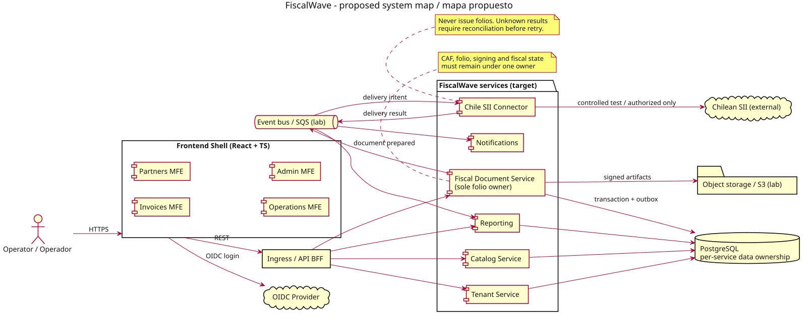

# FiscalWave 🌊

**[English](README.md)** | **ES**

> **Estado: arquitectura y descubrimiento.** No se declara certificación del SII, emisión productiva, procesamiento de pagos ni servicios desplegados.

FiscalWave aspira a ser una plataforma fiscal **API-first, bilingüe y portable entre nubes**. La primera entrega funcional apunta a **documentos tributarios electrónicos (DTE) de Chile**. Los adaptadores de otros países, suscripciones, orquestación de pagos y libro contable son visión futura, **no compromisos del MVP**.

## Objetivos
1. Entregar un flujo chileno de DTE verificable, sin atribuirse autorizaciones del SII inexistentes.
2. Demostrar competencias laborales mediante código real: Java, Spring Boot, SQL, sistemas distribuidos, React/TypeScript, seguridad, pruebas, CI/CD y AWS.
3. Mantener experimentos cloud pequeños y sujetos a aprobación explícita de costos.

## Dirección tecnológica
- **Backend:** Java 21 como base (ensayos de compatibilidad con Java 25), Spring Boot, Maven y PostgreSQL; microservicios desplegables en forma independiente con propiedad de datos.
- **Frontend:** React + TypeScript; shell y microfrontends por dominio; composición a validar con una prueba de concepto.
- **Integración:** OpenAPI, AsyncAPI, patrón outbox, idempotencia, folios y DTE dentro de un dueño transaccional.
- **Infraestructura:** Docker Compose primero; laboratorios temporales AWS ECS/S3/SQS/Lambda/ALB; Terraform y limpieza; portabilidad Azure después.
- **Idiomas:** inglés y español de Chile. El XML tributario se rige por esquemas del país, no por traducciones UI.

### Dominios propuestos, no implementados aún
`tenant`, `catalog`, `fiscal-document`, `chile-sii-connector`, `notification`, `reporting`. Primera entrega vertical: DTE + simulador/conector SII + interfaz mínima. Microfrontends proyectados: facturas, terceros, operaciones, administración y shell.

## Guías
- [Visión](docs/es/vision.md) · [Arquitectura](docs/es/architecture.md) · [Hoja de ruta](docs/es/roadmap.md)
- [Selección secuencial de IA](docs/planning/AI-AGENT-STRATEGY.md) · [Stack objetivo](docs/planning/STACK-BASELINE.md) · [Primer desarrollo FW-002](docs/planning/M1-KICKOFF.md)
- [Coordinación de agentes y worktrees](docs/planning/MULTI_AGENT.md) · [Protección de datos personales de Chile](docs/privacy/README.md) · [Repositorios por país](docs/adr/0010-country-repository-strategy.md)
- [Backlog y Scrum](docs/planning/README.md) · [CI/CD](docs/planning/CICD.md) · [Práctica de entrevistas](docs/planning/INTERVIEWS.md)
- [FinOps](docs/planning/FINOPS.md) · [Cumplimiento SII](docs/planning/COMPLIANCE.md)
- [Redis/MongoDB](docs/planning/DATA-PLATFORMS.md) · [PFX/CAF, XSD y PDF417](docs/planning/SII-DTE-LIFECYCLE.md) · [Comparativa LibreDTE](docs/planning/PROVIDER-CAPABILITIES.md)
- [Localización](docs/planning/I18N.md) · [Instrucciones para agentes](AGENTS.md)
- [SOLID y estándares](docs/es/engineering-standards.md) · [Patrones de diseño](docs/architecture/pattern-catalog.md) · [Contrato de idempotencia](docs/architecture/idempotency-contract.md)
## Diagramas de arquitectura

[Ver galería bilingüe](docs/architecture/diagrams.md) con los seis diagramas propuestos en SVG, vistas Mermaid nativas de GitHub y archivos PlantUML originales.

Para regenerar los diagramas: `bash scripts/render-diagrams.sh` (requiere PlantUML y Graphviz). Los SVG exportados tienen fondo blanco opaco y texto oscuro para verse correctamente en el modo oscuro de GitHub; las vistas Mermaid siguen el tema del renderizador de GitHub. GitHub Actions comprueba la sincronización. **Son diseños propuestos, no servicios desplegados.**

## Colaboración y transparencia
Revisar [CONTRIBUTING](CONTRIBUTING.md) y [Definition of Done](docs/planning/QUALITY.md). No subir certificados, CAF reales, datos de clientes, claves ni secretos. Licencia existente: [Apache-2.0](LICENSE).
