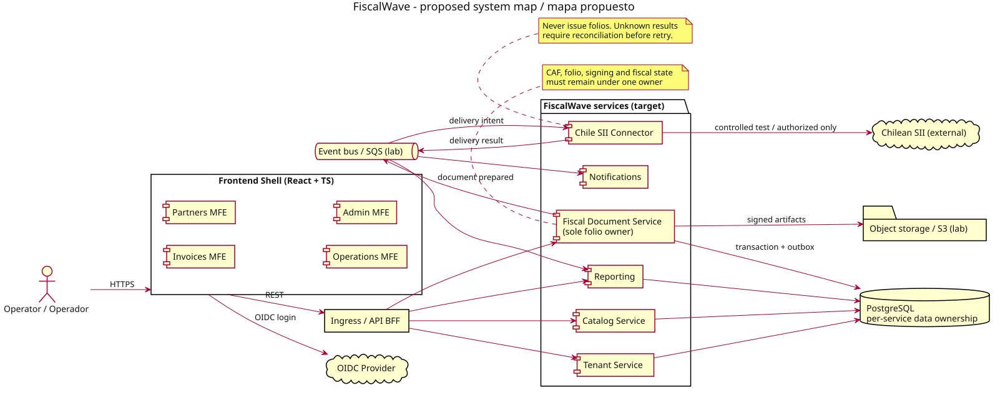

# FiscalWave 🌊

**EN** | [Español](README.es.md)

> **Status: architecture / discovery.** No SII certification, production issuance, payment processing or deployed services is claimed.

FiscalWave is an **API-first, bilingual, cloud-portable fiscal technology platform**. The first product slice targets **electronic tax documents (DTE) for Chile**; future jurisdiction adapters, billing, payment orchestration and ledger capabilities are hypotheses, **not MVP commitments**.

## Goals
1. Deliver a verifiable Chilean DTE workflow without misrepresenting SII authorization.
2. Build a demonstrable engineering portfolio: Java, Spring Boot, SQL, distributed systems, React/TypeScript, security, testing, CI/CD and AWS.
3. Keep cloud experiments inexpensive and explicitly approved.

## Architectural direction
- **Backend:** Java 21 baseline (Java 25 compatibility experiments), Spring Boot, Maven, PostgreSQL. Multiple independently deployable microservices with **data ownership**.
- **Frontend:** React + TypeScript, application shell and domain-oriented microfrontends; composition strategy to be proven in a spike.
- **Integration:** OpenAPI, AsyncAPI, transactional outbox, idempotency, strict fiscal document/folio ownership.
- **Infrastructure:** Docker Compose first; AWS ECS/S3/SQS/Lambda/ALB as short-lived labs; Terraform with destructive cleanup; Azure portability later.
- **Language:** English and Spanish (Chile). UI strings use locale catalogs; tax-authoritative XML must follow local legal schemas.

### Proposed bounded contexts (not all implemented on day one)
`tenant`, `catalog`, `fiscal-document`, `chile-sii-connector`, `notification`, `reporting`. First vertical slice: fiscal document + SII simulator/connector + minimal portal. Planned MFEs: invoices, partners, operations, admin, composed by a shell.

## Documentation
| Topic | English | Español |
|---|---|---|
| Product and scope | [Vision](docs/en/vision.md) | [Visión](docs/es/vision.md) |
| Architecture | [Architecture](docs/en/architecture.md) | [Arquitectura](docs/es/architecture.md) |
| SOLID, coding standards & patterns | [Engineering standards](docs/en/engineering-standards.md) | [Estándares de ingeniería](docs/es/engineering-standards.md) |
| Idempotency & pattern catalog | [Idempotency](docs/architecture/idempotency-contract.md) · [Patterns](docs/architecture/pattern-catalog.md) | [Idempotencia](docs/architecture/idempotency-contract.md) · [Patrones](docs/architecture/pattern-catalog.md) |
| Roadmap | [Roadmap](docs/en/roadmap.md) | [Hoja de ruta](docs/es/roadmap.md) |
| M0 foundation review | [M0 release evidence](docs/planning/M0-REVIEW.md) | [Evidencia de revisión M0](docs/planning/M0-REVIEW.md) |
| Backlog, milestones & Scrum | [Planning / Planificación](docs/planning/README.md) | [Planning / Planificación](docs/planning/README.md) |
| Interviews (original practice exercises) | [Technical practice / Práctica](docs/planning/INTERVIEWS.md) | [Technical practice / Práctica](docs/planning/INTERVIEWS.md) |
| Cloud cost safety | [FinOps / Costos](docs/planning/FINOPS.md) | [FinOps / Costos](docs/planning/FINOPS.md) |
| Regulatory readiness | [Compliance / Cumplimiento](docs/planning/COMPLIANCE.md) | [Compliance / Cumplimiento](docs/planning/COMPLIANCE.md) |
| Localisation | [i18n / Localización](docs/planning/I18N.md) | [i18n / Localización](docs/planning/I18N.md) |
| Agent instructions | [AGENTS.md](AGENTS.md) | [AGENTS.md](AGENTS.md) |
| Sequential AI agent selection | [FW-032 policy](docs/planning/AI-AGENT-STRATEGY.md) | [Selección y traspaso de IA](docs/planning/AI-AGENT-STRATEGY.md) |
| Initial stack and M1 kickoff | [Stack](docs/planning/STACK-BASELINE.md) · [FW-002 kickoff](docs/planning/M1-KICKOFF.md) | [Stack](docs/planning/STACK-BASELINE.md) · [Inicio FW-002](docs/planning/M1-KICKOFF.md) |
| Multi-agent development | [Worktree & PR ownership](docs/planning/MULTI_AGENT.md) | [Coordinación multiagente](docs/planning/MULTI_AGENT.md) |
| Chile Law 21.719 | [Privacy readiness](docs/privacy/README.md) | [Programa de privacidad](docs/privacy/README.md) |
| Country repo architecture | [ADR-0010](docs/adr/0010-country-repository-strategy.md) | [ADR-0010](docs/adr/0010-country-repository-strategy.md) |
| CI/CD design | [Delivery pipeline](docs/planning/CICD.md) | [Entrega continua](docs/planning/CICD.md) |
| Redis and MongoDB | [Data platforms](docs/planning/DATA-PLATFORMS.md) | [Plataformas de datos](docs/planning/DATA-PLATFORMS.md) |
| PFX/CAF, XSD, XMLDSig and PDF417 | [SII DTE lifecycle](docs/planning/SII-DTE-LIFECYCLE.md) | [Ciclo DTE SII](docs/planning/SII-DTE-LIFECYCLE.md) |
| Provider features | [LibreDTE and providers](docs/planning/PROVIDER-CAPABILITIES.md) | [LibreDTE y proveedores](docs/planning/PROVIDER-CAPABILITIES.md) |

## Architecture diagrams / Diagramas

[Open the bilingual diagram gallery](docs/architecture/diagrams.md) for the six proposed architectures, including GitHub-visible SVG images, native Mermaid previews and canonical PlantUML sources.

Generate locally with `bash scripts/render-diagrams.sh` (requires PlantUML and Graphviz). GitHub Actions checks the generated files against the PlantUML sources. **These are proposed designs, not deployed systems.**

## Contributing and transparency
See [CONTRIBUTING](CONTRIBUTING.md), [AGENTS](AGENTS.md) and the [Definition of Done](docs/planning/QUALITY.md). No secret, real taxpayer certificate/CAF, RUT dataset, customer invoice or AWS credential belongs in Git.

## License
Apache-2.0 as found in [LICENSE](LICENSE); future commercial modules require an explicit licensing decision and legal review.
