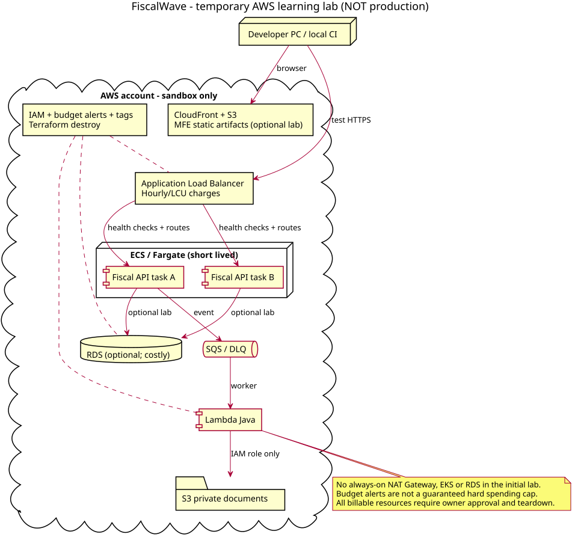
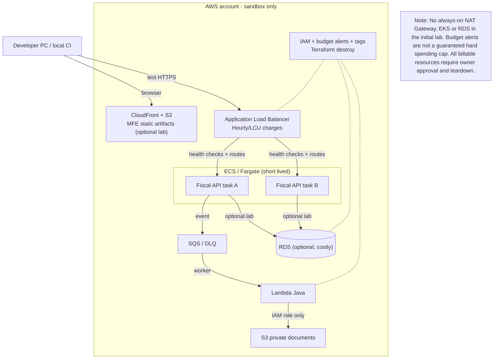
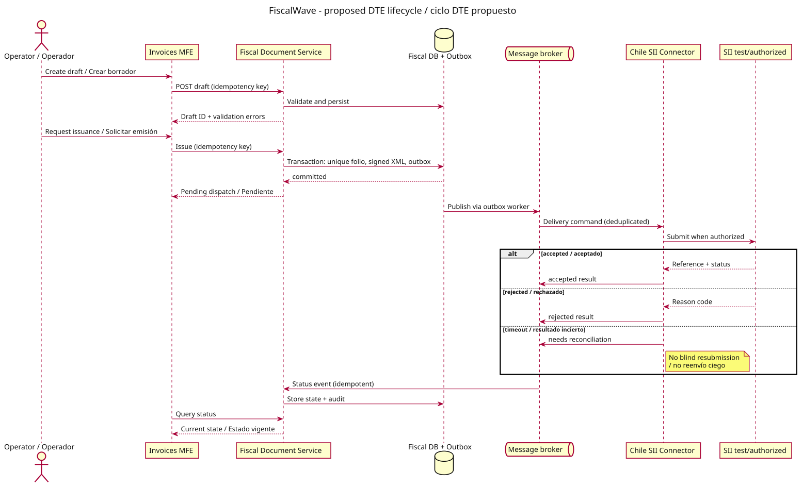
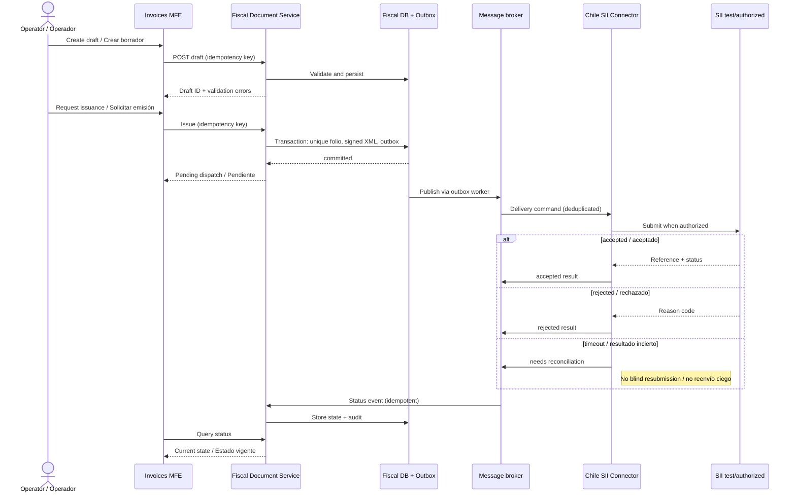
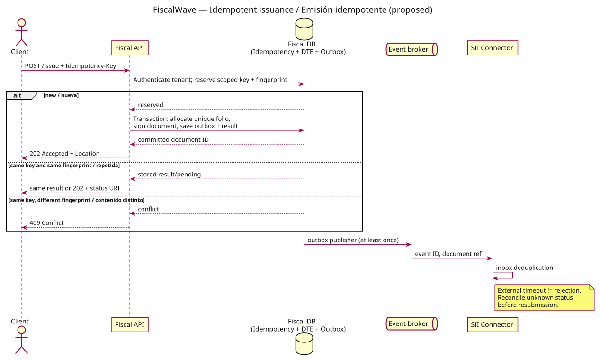
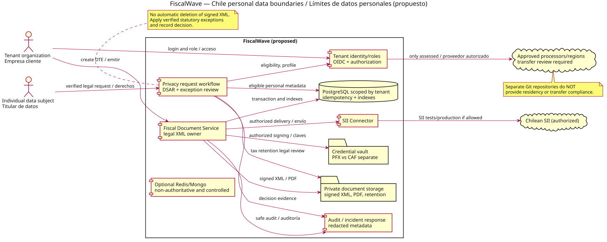
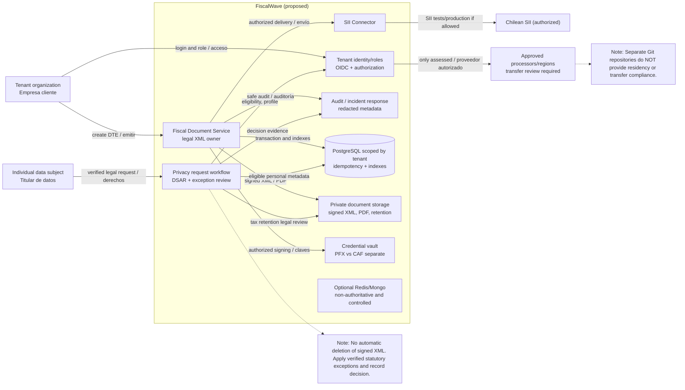
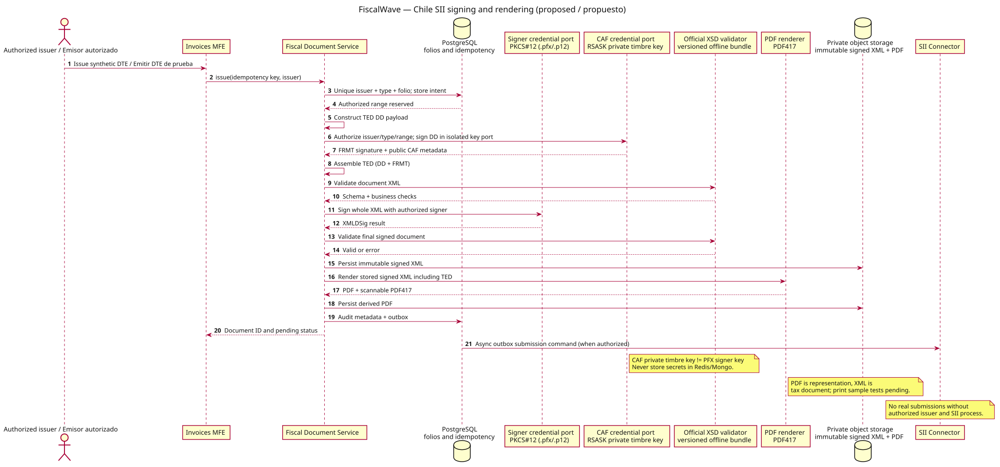
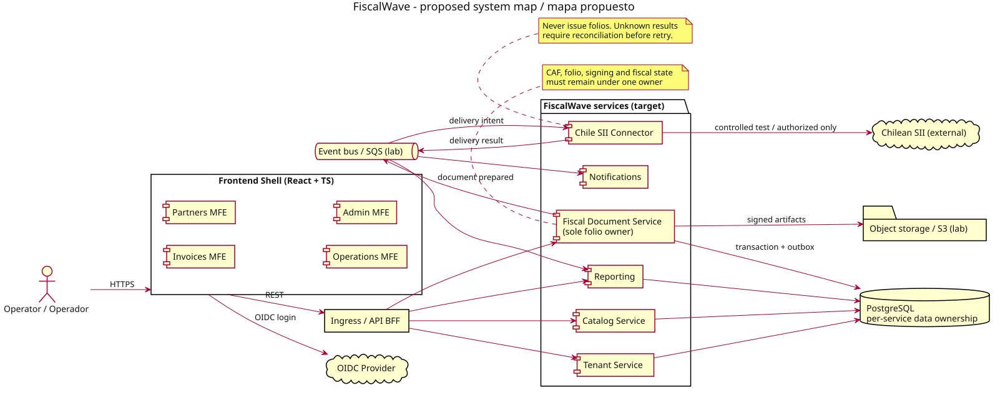
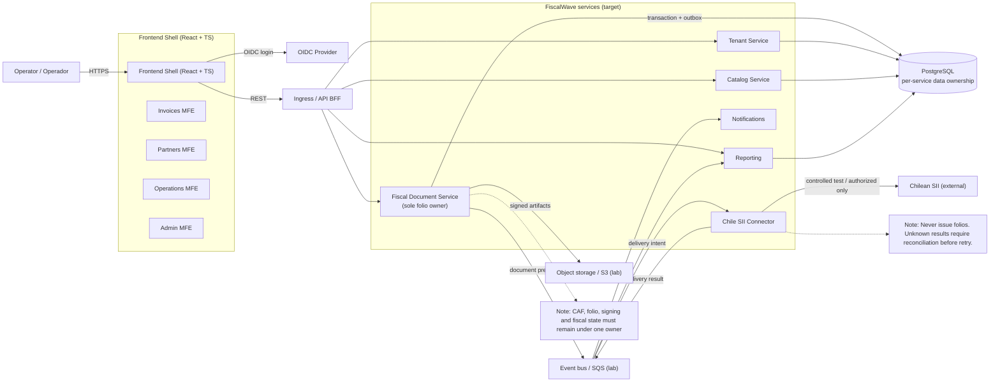

# FiscalWave diagrams / Diagramas

**EN:** Proposed architecture only, not implemented services or SII authorization. PlantUML (`.puml`) is the source of truth. SVGs and supported Mermaid views are derived.

**ES:** Arquitectura propuesta, no servicios implementados ni autorización del SII. PlantUML (`.puml`) es la fuente de verdad. SVG y Mermaid son vistas derivadas.

Generate / Generar from the repository root: `bash scripts/render-diagrams.sh`. CI validates both rendered SVG and deterministic Mermaid output.

Conversion is strict and limited to the PlantUML constructs in this repository. Unsupported syntax fails CI rather than producing an incomplete diagram. Mermaid may use simplified shapes/layout, and visual equivalence still requires human review.

## Temporary AWS lab / Laboratorio AWS temporal

[PlantUML source](aws-lab.puml) · [Mermaid source](mermaid/aws-lab.mmd) · [SVG](rendered/aws-lab.svg)



<details>
<summary>Mermaid / Diagrama Mermaid</summary>



</details>

## DTE lifecycle / Ciclo de vida DTE

[PlantUML source](dte-lifecycle.puml) · [Mermaid source](mermaid/dte-lifecycle.mmd) · [SVG](rendered/dte-lifecycle.svg)



<details>
<summary>Mermaid / Diagrama Mermaid</summary>



</details>

## Idempotent issuance / Emisión idempotente

[PlantUML source](idempotency-sequence.puml) · [Mermaid source](mermaid/idempotency-sequence.mmd) · [SVG](rendered/idempotency-sequence.svg)



<details>
<summary>Mermaid / Diagrama Mermaid</summary>

```mermaid
%% Generated from idempotency-sequence.puml; edit the PlantUML source, not this file.
sequenceDiagram
    actor Client as Client
    participant API as Fiscal API
    participant DB as Fiscal DB<br/>(Idempotency + DTE + Outbox)
    participant Q as Event broker
    participant SII as SII Connector
    Client->>API: POST /issue + Idempotency-Key
    API->>DB: Authenticate tenant; reserve scoped key + fingerprint
    alt new / nueva
    DB-->>API: reserved
    API->>DB: Transaction: allocate unique folio,<br/>sign document, save outbox + result
    DB-->>API: committed document ID
    API-->>Client: 202 Accepted + Location
    else same key and same fingerprint / repetida
    DB-->>API: stored result/pending
    API-->>Client: same result or 202 + status URI
    else same key, different fingerprint / contenido distinto
    DB-->>API: conflict
    API-->>Client: 409 Conflict
    end
    DB->>Q: outbox publisher (at least once)
    Q->>SII: event ID, document ref
    SII->>SII: inbox deduplication
    Note right of SII: External timeout != rejection. Reconcile unknown status before resubmission.
```

</details>

## Personal-data boundaries / Límites de datos personales

[PlantUML source](privacy-boundaries.puml) · [Mermaid source](mermaid/privacy-boundaries.mmd) · [SVG](rendered/privacy-boundaries.svg)



<details>
<summary>Mermaid / Diagrama Mermaid</summary>



</details>

## SII signing and PDF / Firma SII y PDF

[PlantUML source](sii-signing-and-pdf.puml) · [Mermaid source](mermaid/sii-signing-and-pdf.mmd) · [SVG](rendered/sii-signing-and-pdf.svg)



<details>
<summary>Mermaid / Diagrama Mermaid</summary>

```mermaid
%% Generated from sii-signing-and-pdf.puml; edit the PlantUML source, not this file.
sequenceDiagram
    autonumber
    actor User as Authorized issuer / Emisor autorizado
    participant MFE as Invoices MFE
    participant Fiscal as Fiscal Document Service
    participant DB as PostgreSQL<br/>folios and idempotency
    participant PFX as Signer credential port<br/>PKCS#12 (.pfx/.p12)
    participant CAF as CAF credential port<br/>RSASK private timbre key
    participant XSD as Official XSD validator<br/>versioned offline bundle
    participant PDF as PDF renderer<br/>PDF417
    participant Store as Private object storage<br/>immutable signed XML + PDF
    participant SII as SII Connector
    User->>MFE: Issue synthetic DTE / Emitir DTE de prueba
    MFE->>Fiscal: issue(idempotency key, issuer)
    Fiscal->>DB: Unique issuer + type + folio; store intent
    DB-->>Fiscal: Authorized range reserved
    Fiscal->>Fiscal: Construct TED DD payload
    Fiscal->>CAF: Authorize issuer/type/range; sign DD in isolated key port
    CAF-->>Fiscal: FRMT signature + public CAF metadata
    Fiscal->>Fiscal: Assemble TED (DD + FRMT)
    Fiscal->>XSD: Validate document XML
    XSD-->>Fiscal: Schema + business checks
    Fiscal->>PFX: Sign whole XML with authorized signer
    PFX-->>Fiscal: XMLDSig result
    Fiscal->>XSD: Validate final signed document
    XSD-->>Fiscal: Valid or error
    Fiscal->>Store: Persist immutable signed XML
    Fiscal->>PDF: Render stored signed XML including TED
    PDF-->>Fiscal: PDF + scannable PDF417
    Fiscal->>Store: Persist derived PDF
    Fiscal->>DB: Audit metadata + outbox
    Fiscal-->>MFE: Document ID and pending status
    DB->>SII: Async outbox submission command (when authorized)
    Note right of CAF: CAF private timbre key != PFX signer key Never store secrets in Redis/Mongo.
    Note right of PDF: PDF is representation, XML is tax document; print sample tests pending.
    Note over SII: No real submissions without authorized issuer and SII process.
```

</details>

## System map / Mapa del sistema

[PlantUML source](system-map.puml) · [Mermaid source](mermaid/system-map.mmd) · [SVG](rendered/system-map.svg)



<details>
<summary>Mermaid / Diagrama Mermaid</summary>



</details>
